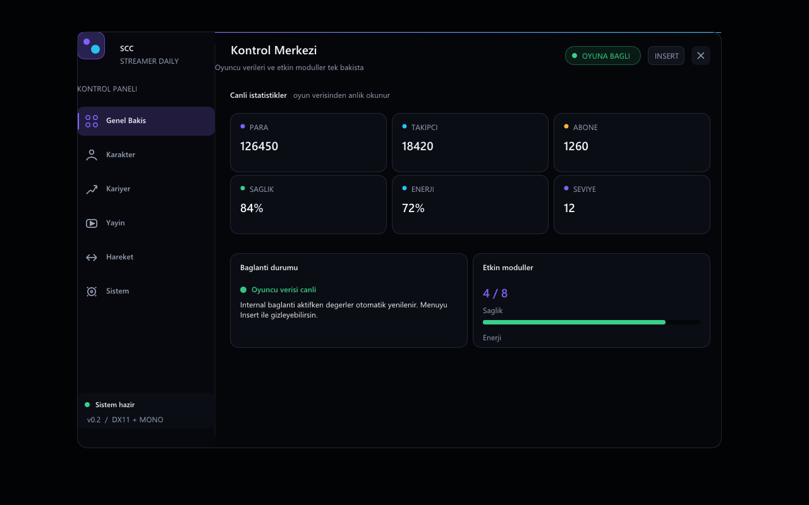
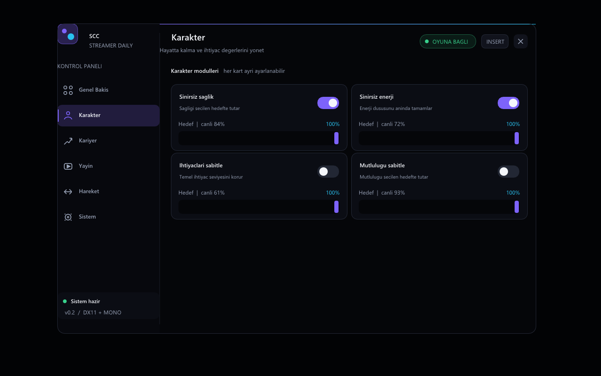
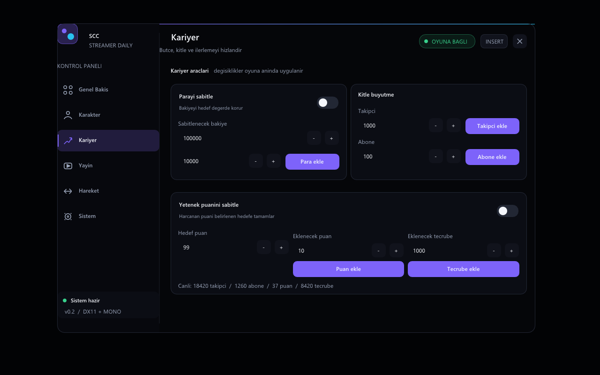
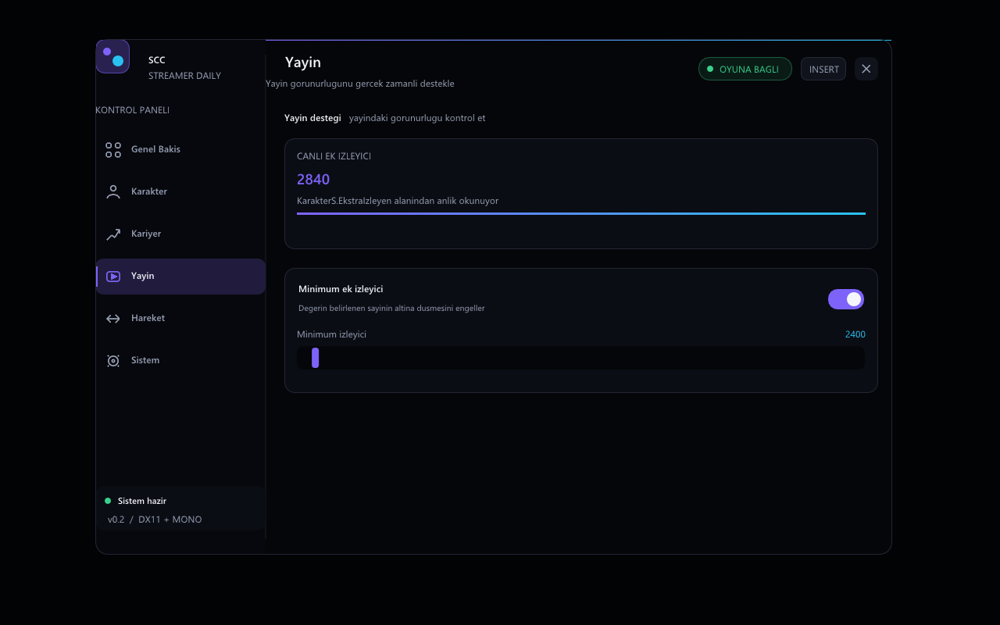
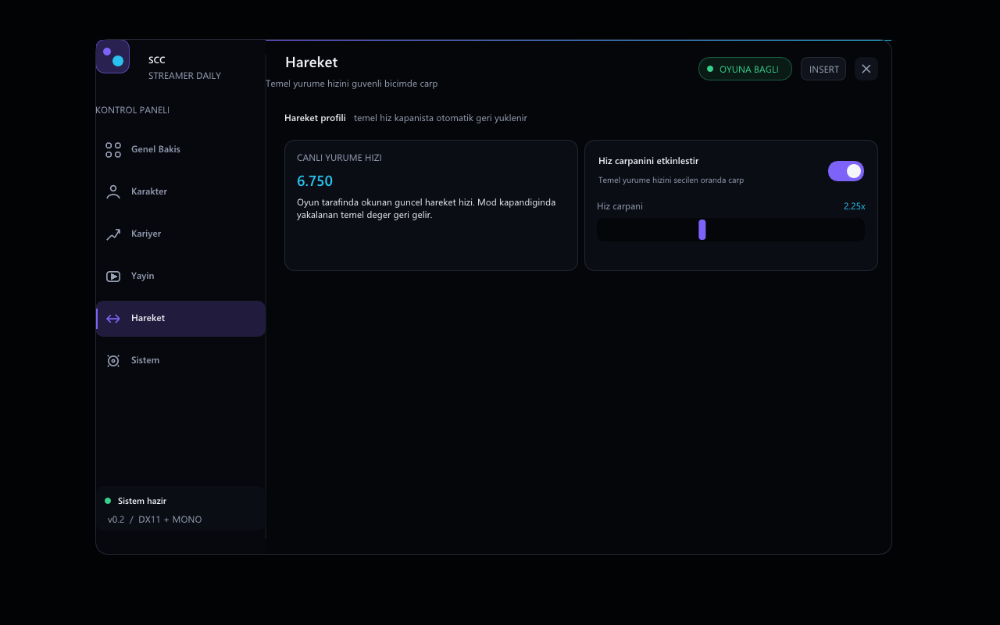
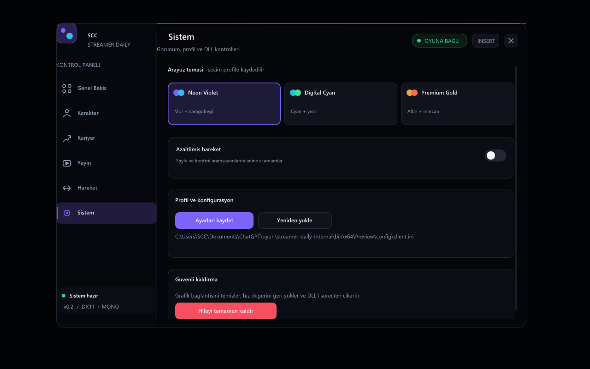

# SCC — Streamer Daily

**Türkçe** · [English](README.md)

SCC, Steam sürümündeki **Streamer Daily** için modern bir oyun içi kontrol panelidir. x64 internal DLL, Dear ImGui / DirectX 11 arayüzü, canlı Mono veri erişimi, kalıcı profil ve temiz kaldırma desteği içerir.

> Bu repo Steam build `6248886` sürümüne kilitlidir. Eğitim ve tek oyunculu kullanım içindir. Oyun geliştiricisi/yayıncısıyla bağlantılı değildir ve anti-cheat atlatma içermez.

## Menü önizlemeleri



| Karakter kontrolleri | Kariyer kontrolleri |
|---|---|
|  |  |

| Yayın kontrolleri | Hareket kontrolleri |
|---|---|
|  |  |



## Özellikler

- **Genel bakış:** para, takipçi, abone, sağlık, enerji, seviye ve bağlantı durumu.
- **Karakter:** sağlık, enerji, ihtiyaç ve mutluluğu ayrı hedeflerde sabitleme.
- **Kariyer:** para sabitleme/ekleme; takipçi, abone, yetenek puanı ve tecrübe ekleme.
- **Yayın:** ek izleyiciyi yapılandırılabilir minimum değerin üzerinde tutma.
- **Hareket:** kapanınca temel değeri geri yükleyen `0.50x–5.00x` yürüyüş hızı çarpanı.
- **Arayüz:** yeniden boyutlandırılabilir premium siyah tasarım, animasyonlu kontroller, klavye gezinmesi ve üç vurgu teması.
- **Profil:** INI kaydı, kaydet/yükle düğmeleri ve azaltılmış hareket seçeneği.
- **Temiz kaldırma:** giriş/grafik bağlantılarını kaldırır, yakalanan hızı geri verir ve oyunu kapatmadan DLL'yi boşaltır.

## Hızlı kurulum

1. Reponun **Releases** sayfasından `SCC-StreamerDaily-<sürüm>.zip` dosyasını indir.
2. Arşivin tamamını kalıcı bir klasöre çıkart; ZIP içinden çalıştırma.
3. Streamer Daily'yi Steam üzerinden aç ve kayıtlı oyuna gir.
4. `SCC-StreamerDaily-Aktif-Et.cmd` dosyasını çalıştır.
5. SCC menüsünü açıp kapatmak için `Insert` tuşunu kullan.
6. Profili saklamak için **Sistem → Ayarları kaydet** düğmesine bas.
7. DLL'yi değiştirmeden veya silmeden önce **Sistem → Hileyi tamamen kaldır** düğmesini kullan.

Başlatıcı yükleme yapmadan önce oyun EXE'sini ve `Assembly-CSharp.dll` hash değerini doğrular. Farklı oyun sürümünde eski adresleri kullanmak yerine işlemi güvenli biçimde durdurur.

Kaynak koddan derleme, sorun giderme ve temiz kaldırma için [ayrıntılı Türkçe kurulum rehberine](docs/INSTALLATION.tr.md) bak.

## Kaynak koddan derleme

Gereksinimler:

- Windows 10/11 x64
- MSVC v143 ve Windows SDK içeren Visual Studio 2022 C++ Build Tools
- PowerShell 5.1 veya üzeri

```powershell
.\Build-StreamerDaily.ps1
```

Çıktı:

```text
bin\x64\Release\SCC-StreamerDaily.dll
```

Gerekli Dear ImGui ve MinHook kaynakları repoda sabit sürümleriyle bulunur. Lisanslar için [THIRD_PARTY.md](THIRD_PARTY.md) dosyasına bak.

## Teknik bilgiler

- Unity `2019.4.20`, Mono, x64, DirectX 11
- Veri zinciri: `OP.bu → OyuncuChar → veri → KarakterS`
- MinHook ile Present / ResizeBuffers bağlantıları
- Mono güncellemesi render iş parçacığından ayrı, yaklaşık 30 Hz
- Profil: `bin\x64\Release\config\client.ini`
- Kayıt: `bin\x64\Release\SCC-StreamerDaily.log`

## Lisans

MIT. Üçüncü taraf bileşenler kendi lisanslarını korur. Yalnız izinli ortamlarda sorumlu biçimde kullan.

